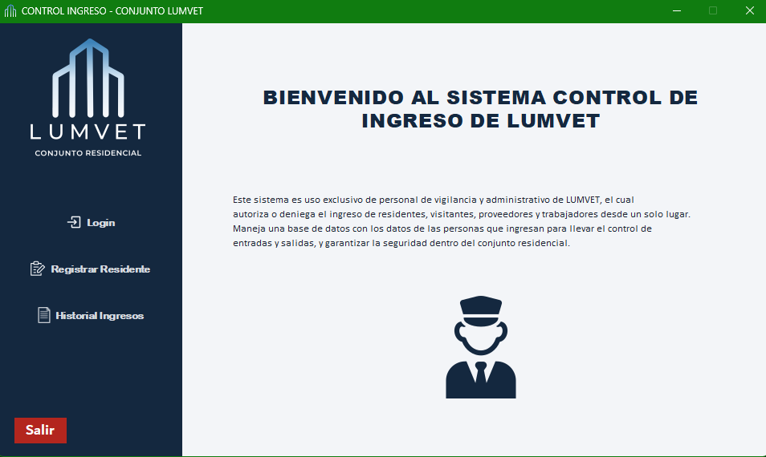
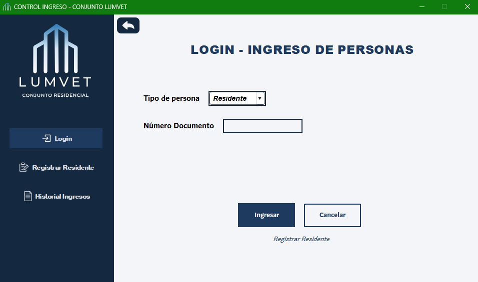
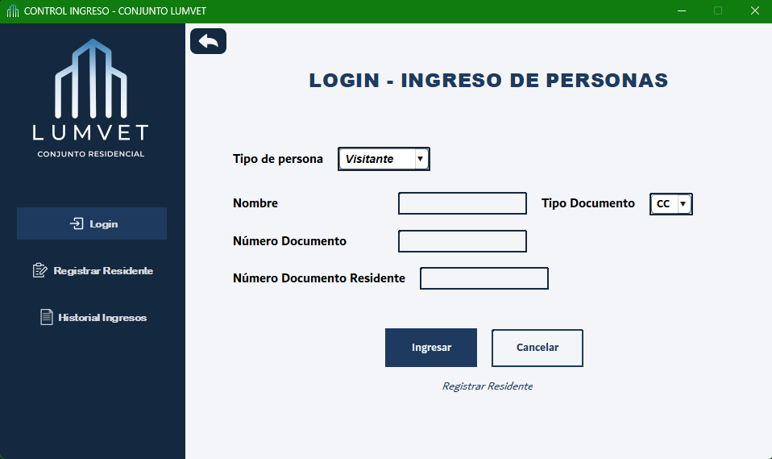
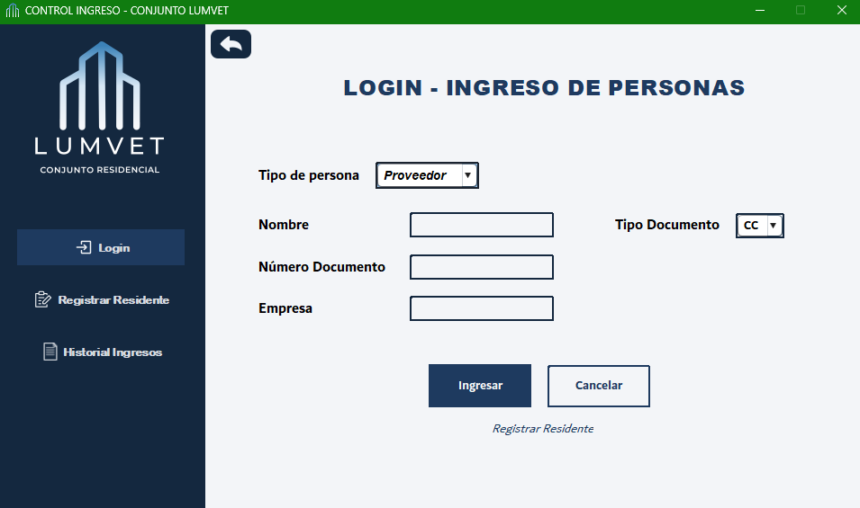
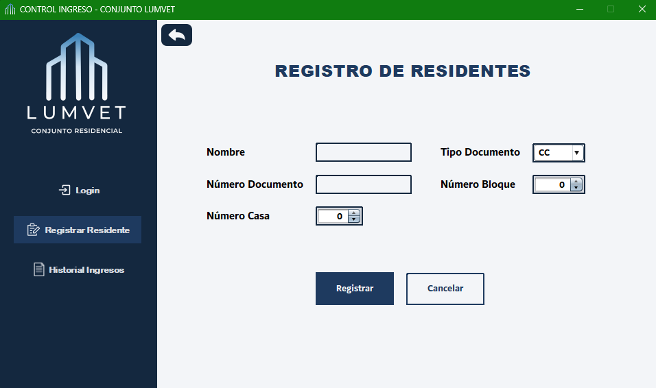
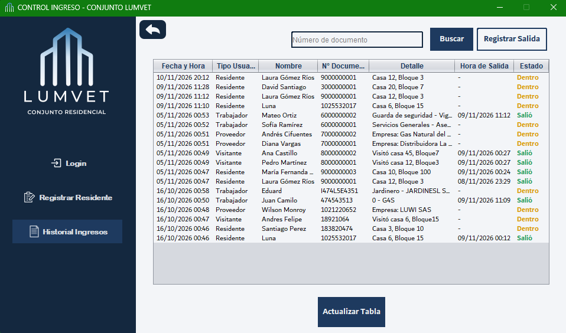
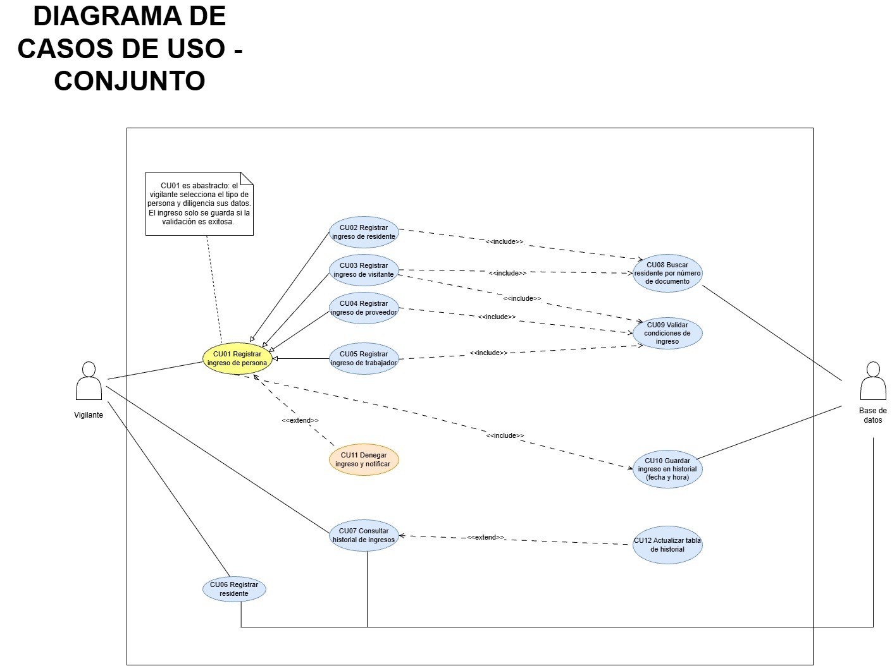
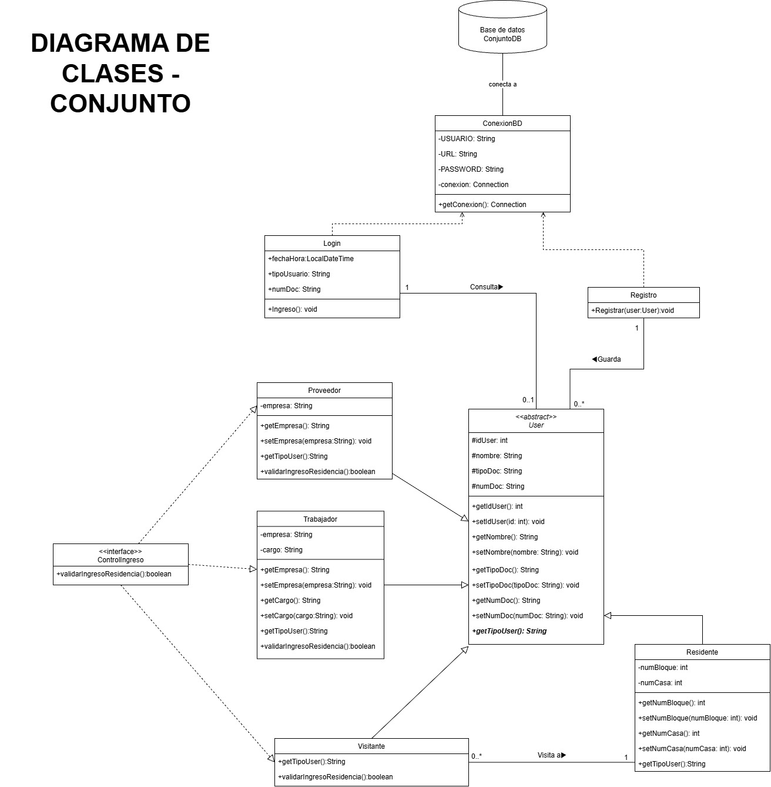
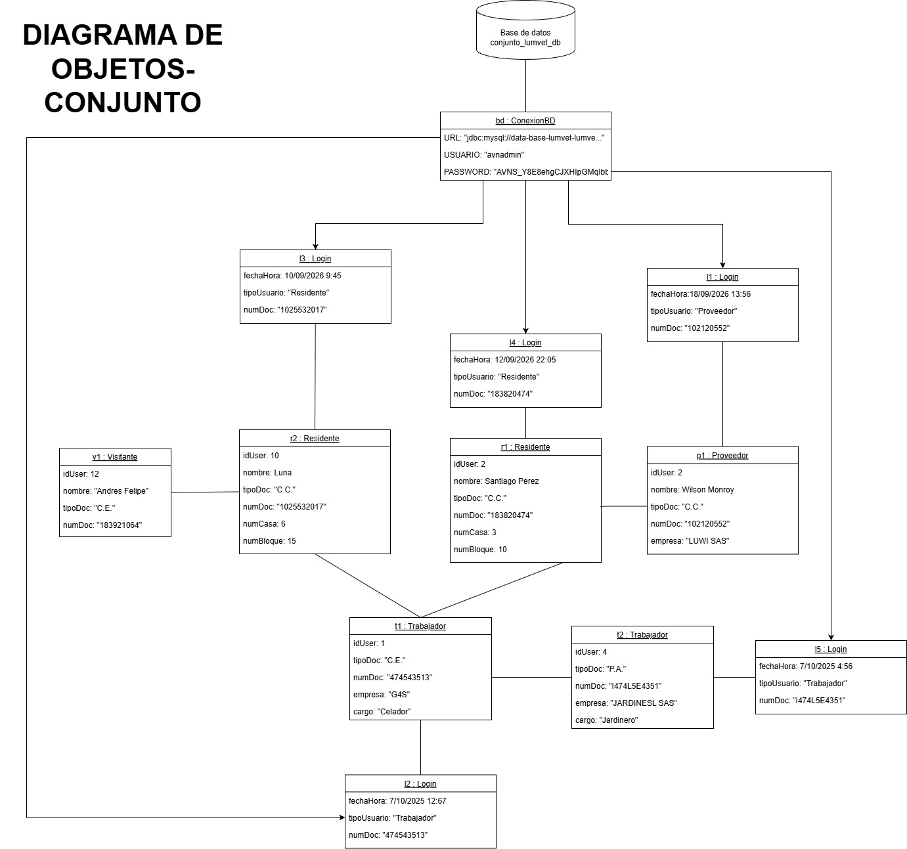
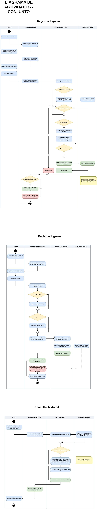

# 🏢 Sistema de Control de Ingreso – Conjunto LUMVET

Aplicación de escritorio para que el personal de vigilancia y administración del conjunto residencial **LUMVET** controle, desde un solo lugar, quién entra y sale del conjunto.

## ¿Qué hace?

- **Autoriza o deniega el ingreso** de residentes, visitantes, proveedores y trabajadores.
- **Registra residentes** (nombre, documento, casa y bloque).
- **Guarda un historial** de entradas y salidas con fecha, hora y estado (*Dentro* / *Salió*).
- **Busca por número de documento** y permite **registrar la salida** de una persona.

### Reglas de ingreso

| Tipo de persona | Datos que se piden | Condición para entrar |
|---|---|---|
| Residente | Número de documento | Debe estar registrado |
| Visitante | Nombre, documento, documento del residente a visitar | El residente visitado debe existir |
| Proveedor | Nombre, documento, empresa | — |
| Trabajador | Nombre, documento, empresa, cargo | — |

## 🛠️ Tecnologías

- Java (Swing, proyecto de NetBeans)
- MySQL (JDBC)
- Patrón DAO + capa de controlador

## 📁 Estructura

```
src/com/conjunto/lumvet/
├── model/        Clases del dominio (User, Residente, Visitante, Proveedor, Trabajador...)
├── dao/          Acceso a la base de datos
├── controller/   Lógica de ingreso
├── gui/          Pantallas (menú, login, registro, historial)
└── data/         Script SQL de la base de datos
```

## ▶️ Cómo ejecutarlo

1. Crear la base de datos con el script `src/com/conjunto/lumvet/data/scriptMYSQLWorkbench.sql`.
2. Configurar la conexión en `dao/ConexionBD.java`.
3. Abrir el proyecto en NetBeans y ejecutar `MainFrame`.

## 📸 Capturas de pantalla

### Inicio


### Login de ingreso

| Residente | Visitante |
|---|---|
|  |  |

| Proveedor | Trabajador |
|---|---|
|  |  |

### Registro de residente


### Historial de ingresos


## 📐 Diagramas

### Casos de uso


### Clases


### Objetos


### Actividades



## 🧑🏻‍💻Integrantes:👩🏻‍💻

- **Luna Gómez** Programadora
- **Sara Lamprea** Programadora
- **Kevin Saganome** Programador
- **Wilson Monroy** Programador